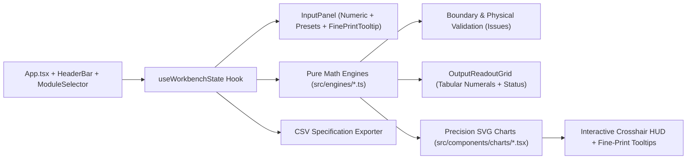

# ThermoChem Bench


An interactive, client-side calculation workbench for **Mechanical and Chemical Engineers**. Enter numeric operating parameters, inspect live computed engineering outputs with explicit validation bounds, explore 10 precision interactive SVG diagrams with live crosshair coordinates, and inspect governing equations and assumptions via **fine-print tooltips**.

---

## Engineering Modules Included

| # | Diagram / Tool | Discipline | Key Inputs | Computed Outputs & Plot Features |
|---|---|---|---|---|
| 01 | **Psychrometric Chart** | Thermodynamics & HVAC | Any pair (`T_db + RH`, `T_db + T_wb`, `T_db + T_dp`), `P_atm` | Wet-bulb, dew point, humidity ratio `W`, enthalpy `h`, specific volume `v`, saturation/RH/enthalpy contours |
| 02 | **Moody Chart** | Fluid Mechanics | Reynolds number `Re`, pipe diameter `D`, roughness `ε` | Darcy–Weisbach `f` (Colebrook–White), Fanning `f_F`, `ε/D`, flow regime classification on log-log plot |
| 03 | **Mollier Diagram (h–s)** | Thermodynamics & HVAC | `P₁`, `T₁`, exhaust `P₂`, isentropic efficiency `η_s` | Isentropic drop `Δh_s`, actual turbine work `w_t`, exhaust quality `x₂`, `T₂`, `Δs_gen`, saturation dome & isobars |
| 04 | **P–h Diagram (Refrigeration)** | Thermodynamics & HVAC | Refrigerant (`R134a`, `R410A`, `R32`, `R717`, `R290`), `T_evap`, `T_cond`, superheat, subcool, `η_c`, `ṁ` | Cooling capacity `Q̇_L`, compressor power `Ẇ_c`, `COP_R`, Carnot `COP_max`, 4-state log-P vs. `h` loop |
| 05 | **T–s & P–v Cycle Diagrams** | Thermodynamics & HVAC | Cycle (`Otto`, `Diesel`, `Brayton`, `Rankine`), compression/pressure ratio, `T₁`, `T₃`, `P₁`, `γ` | Net work `w_net`, `q_in / q_out`, thermal efficiency `η_th`, `MEP` / Back-Work Ratio, dual synchronized loops |
| 06 | **McCabe–Thiele Diagram** | Separations | Relative volatility `α`, `z_F`, `x_D`, `x_B`, feed quality `q`, reflux ratio `R` | `R_min`, Fenske `N_min`, exact stepped theoretical trays `N_th`, optimal feed tray, VLE + operating lines |
| 07 | **Ternary Phase Diagram** | Separations | Fractions `x_A`, `x_B`, `x_C`, temperature `T` | Single vs. two-phase miscibility, active conjugate tie-line, Raffinate & Extract compositions, Lever Rule split |
| 08 | **Iron–Carbon Phase Diagram** | Metallurgy | Carbon weight `%` (`0–6.67%`), temperature `T` | Alloy classification, equilibrium phases (`α`, `γ`, `δ`, `Fe₃C`, `L`), Lever Rule tie-line weight fractions |
| 09 | **TTT Diagram** | Metallurgy | Steel grade (`1045`, `1080`, `4140`, `4340`), Isothermal hold or Continuous cooling rate | Microstructure (`Pearlite`, `Bainite`, `Martensite`), Rockwell `HRC` & `HV` hardness, logarithmic C-curves |
| 10 | **Pump & System Head Curve** | Fluid Mechanics | Speed ratio `N/N₀`, trim `D/D₀`, `H₀`, `Q_BEP`, `H_stat`, `k_sys`, `NPSHa` | Operating `Q_op` & `H_op`, pump efficiency `η`, shaft power `kW`, `NPSH` cavitation margin |

---

## Architecture



---

## Local Development & Testing

```bash
# 1. Install dependencies
npm install

# 2. Start Vite dev server on port 3000
npm run dev

# 3. Run TypeScript typecheck
npm run lint

# 4. Run Vitest + React Testing Library suite
npm test

# 5. Build production static bundle
npm run build
```

---

## GitHub Pages Deployment

Push to the `main` branch to trigger `.github/workflows/deploy.yml`, which runs `tsc --noEmit`, executes the full `vitest` test suite, builds the static bundle with `VITE_BASE_PATH=/<repository-name>/`, and publishes `./dist` to GitHub Pages.
